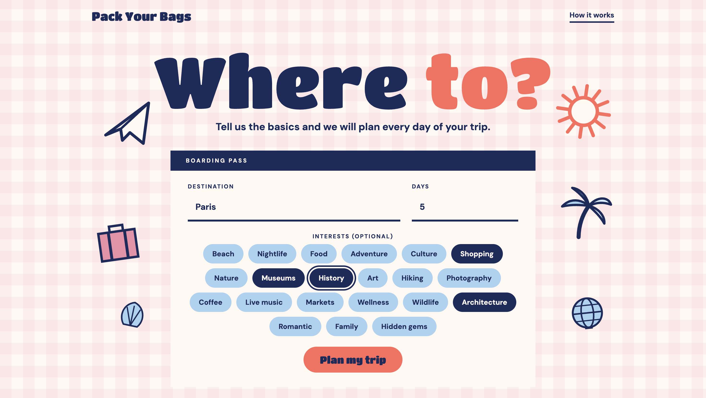
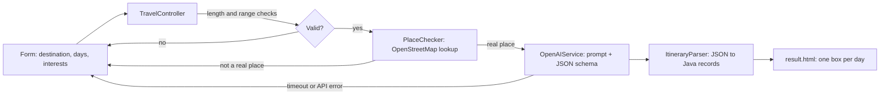

# Pack Your Bags

An AI travel planner built with Java and Spring Boot. Enter a destination, a number of days and a few interests, and it returns a structured, day-by-day itinerary: morning, afternoon and evening plans, practical tips and places to eat.

The interesting part is not the chat call, it is everything around it. The model is forced to answer in a strict JSON schema, the response is parsed into typed Java records, user input is validated and checked against a real place database before any tokens are spent, and failures are handled so the user always gets a clear next step.




## Features

- **Structured AI output.** Uses OpenAI Structured Outputs (`json_schema` with `strict: true`), so every response has the same shape: days, three time slots, tips and restaurants. No regex parsing of free text.
- **Typed domain model.** The JSON is parsed into Java records (`Itinerary`, `Day`, `Restaurant`) and the page is rendered from those objects with Thymeleaf loops.
- **Input validation on the server.** Destination length and day range (1 to 14) are checked in the controller, with field-level error messages shown under each input and the form values kept.
- **Real-place check.** Before calling the model, the destination is looked up in OpenStreetMap (Nominatim). Made-up places such as "Hogwarts" or random text are rejected, which saves API cost and stops the model from inventing a trip.
- **Prompt design.** A system prompt sets the rules (real, well-known places grouped by neighborhood, matched to the chosen interests) and tells the model to treat the user's text as data only, as a basic guard against prompt injection. User input is trimmed and length-capped before it reaches the prompt.
- **Failure handling.** Connect and request timeouts on every outbound call, errors logged on the server, and a plain message with the form still filled in for the user. Unknown URLs get a custom 404 page.
- **No frontend framework.** Plain HTML, CSS and a few lines of JavaScript. Interest bubbles are styled checkboxes, the day boxes use the native `<details>` element, and "How it works" uses the native `<dialog>` element. Fonts are self-hosted.
- **Unit tests** for the JSON parser that run without a network connection or API key.

## How it works



## Tech stack

| Layer | Tools |
| --- | --- |
| Backend | Java 17, Spring Boot 3.5, Spring MVC |
| AI | OpenAI Chat Completions API, Structured Outputs (strict JSON schema), `gpt-4o-mini` (configurable) |
| Data | Java records, `org.json` |
| Frontend | Thymeleaf, HTML, CSS, vanilla JavaScript |
| External APIs | OpenAI, OpenStreetMap Nominatim |
| Testing | JUnit 5, Maven Surefire |
| Build | Maven |

## Project structure

```
src/main/java/com/travel/itinerary/
    ItineraryApplication.java   Spring Boot entry point
    TravelController.java       Routes, input validation, error handling
    OpenAIService.java          Prompt, request body, API call with timeouts
    ItinerarySchema.java        Strict JSON schema sent to the model
    ItineraryParser.java        Turns the model's JSON into Java records
    Itinerary.java              Records: Itinerary, Day, Restaurant
    PlaceChecker.java           Checks the destination is a real place

src/main/resources/
    templates/index.html        Home page and form
    templates/result.html       Itinerary page
    templates/error/404.html    Not found page
    static/css/style.css        All styles
    static/fonts/               Self-hosted fonts
    application.properties      Config (the key comes from .env)

src/test/java/com/travel/itinerary/
    ItineraryParserTest.java    Parser unit tests
```

## Run it locally

You need Java 17 or newer, Maven, and an OpenAI API key.

1. Clone the repository:

   ```
   git clone https://github.com/sara-deshpande/ai-travel-itinerary-planner.git
   cd ai-travel-itinerary-planner
   ```

2. 2. Create a file named `.env` in the project root with your key:
OPENAI_API_KEY=your-key-here

`.env` is in `.gitignore`, so the key is never committed.

3. Start the app:

   ```
   mvn spring-boot:run
   ```

4. Open http://localhost:8080 in a desktop browser. The app shows a "desktop only" message on screens narrower than 900 px.

To use a different model, change `openai.model` in `src/main/resources/application.properties`.

### Run the tests

```
mvn test
```

The parser tests use a fixed JSON sample, so they need no API key or internet connection.

## Notes

- Plans are suggestions generated by an AI model. Check opening hours before you go.
- Place lookups use the free OpenStreetMap Nominatim service, which asks for light use (about one request per second).

Made by Sara Deshpande.